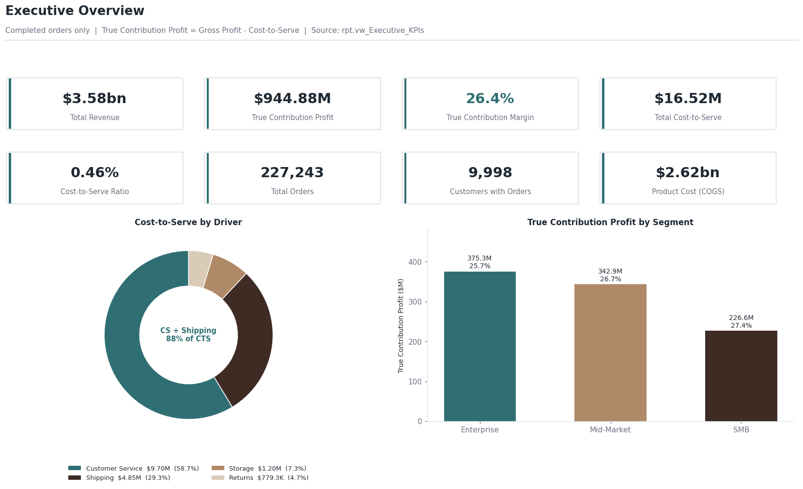
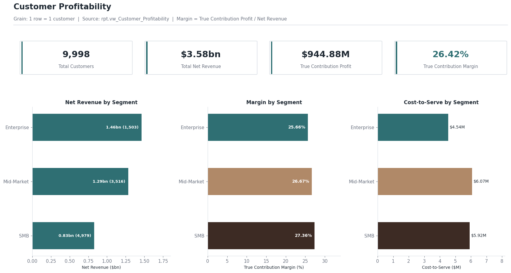
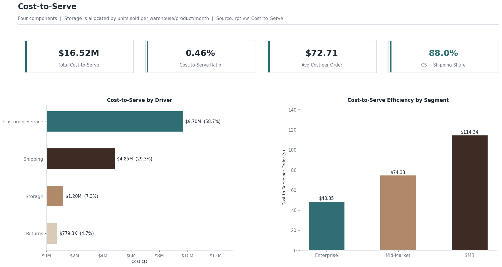
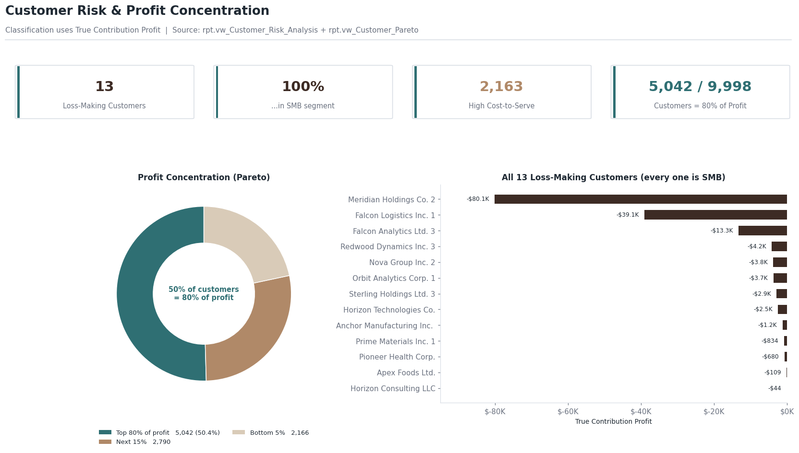
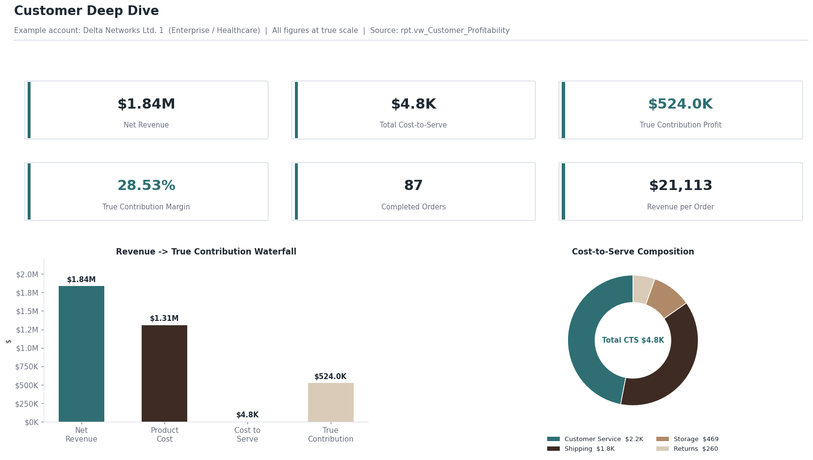

# Profitability & Cost-to-Serve Analysis

**SQL Server · Power BI · Excel**

- Analyzed a **synthetic dataset of 227,000 orders across 10,000 customers** to assess customer-level profitability and cost-to-serve.
- Calculated a **26.4% contribution margin** and identified **13 loss-making customers** requiring profitability reviews.
- Found customer service and shipping accounted for **88% of cost-to-serve**, highlighting opportunities for cost optimization and pricing reviews.

## Overview

An end-to-end analytics pipeline: raw transactional CSVs → SQL Server staging, data-quality audit, validation, and reporting views → interactive Power BI executive dashboard → business recommendations.

The dataset (10 tables, 250,000 orders, 10,000 customers) is synthetic but internally consistent — referential integrity, financial validity, and row-count reconciliation all pass with zero orphaned records. All KPIs cover Completed orders (227,243) across 9,998 active customers.

## Results

| KPI | Value |
|---|---|
| Net Revenue | $3.58B |
| Product Cost (COGS) | $2.62B |
| Gross Profit / Margin | $0.96B / 26.9% |
| Total Cost-to-Serve | $16.52M (0.46% of revenue) |
| True Contribution Profit / Margin | $0.94B / **26.4%** |
| Completed orders | 227,243 |
| Customers analyzed | 9,998 |
| Loss-making customers | **13** (all SMB) |

**Findings**

- **Cost-to-Serve mix is the actionable signal.** Customer Service (58.7%) + Shipping (29.3%) = **88%** of total cost-to-serve; Storage is 7.3%, Returns 4.7%.
- **13 customers are genuinely loss-making** once product cost is accounted for — all in the SMB segment.
- **Profit is concentrated:** 5,042 of 9,998 customers (~50%) generate ~80% of true contribution profit.
- **Segment and industry margins are uniform** (25.7% / 26.7% / 27.4% Enterprise / Mid-Market / SMB), so the opportunity is customer-level cost efficiency, not mix.
- **Metric correction:** the pipeline's original contribution metric excluded COGS and implied a 99.5% margin. The reporting layer was corrected to `True_Contribution_Profit` (GP − Cost-to-Serve), which all results above use.

## Dashboard

Exported report pages (regenerated from the corrected reporting layer; pre-correction exports kept in `dashboard/legacy/`):







## Repository Structure

```text
Dataset/         10 source CSVs (zipped) + Data Dictionary
SQL/             01→10 scripts: init, staging, DQ audit, core load,
                 validation, reporting views, executive KPIs, analysis
Power bi/        Enterprise_Profitability_Final.pbix (6 report pages)
dashboard/       exported report pages (+ legacy/ pre-correction)
Documentation/   KPI_Dictionary.md, PowerBI_Documentation.md
Insights.pdf     full business insights & recommendations report
```

## Run It

1. Extract `Dataset/Enterprise_CostToServe_Dataset.zip`.
2. Run `SQL/01` → `SQL/10` in order (set the CSV folder path in `04_Load_Staging_Data.sql`).
3. Review the data-quality and validation results (`05`, `07`) — expect zero orphaned FK records.
4. Open `Power bi/Enterprise_Profitability_Final.pbix`, connect to your SQL Server instance, and refresh.
5. See `Documentation/PowerBI_Documentation.md` for pointing visuals at the corrected `True_*` metrics (the shipped `.pbix` keeps legacy measures to avoid breaking visuals; its one report-level bug — a mis-filtered Risk-page card — is fixed).

## Verification

Every headline number is documented with its definition and logic in [`Documentation/KPI_Dictionary.md`](Documentation/KPI_Dictionary.md), and was independently reproduced outside SQL Server by re-implementing the reporting-layer logic in Python directly over the raw CSVs:

- Net Revenue 3,576,677,378 · COGS 2,615,275,667 · Gross Profit 961,401,712 (26.88%)
- Cost-to-Serve 16,523,929 = CS 9,696,715 + Shipping 4,847,989 + Storage 1,199,899 + Returns 779,325
- True Contribution Profit 944,877,783 → **26.42%**
- Loss-making (`True_Contribution_Profit < 0`) = **13**, all SMB; segments 4,754 / 3,229 / 2,002 / 13
- Pareto: 5,042 customers → 80% of true contribution profit

The narrative report with charts and recommendations is in [`Insights.pdf`](Insights.pdf).

## Recommendations

1. Investigate the 13 loss-making SMB customers for pricing, service-model, or account-management review.
2. Prioritize customer-service cost efficiency — the single largest cost-to-serve driver.
3. Review shipping-method mix for cost-sensitive customers and segments.
4. Protect and grow the top ~50% of customers generating 80% of profit.
5. Keep validating profitability metrics before using them for commercial decisions.

## Assumptions

- Completed orders are the analytical population; cancelled/returned orders are excluded from profitability views.
- Storage cost is allocated per order by warehouse, product, and month (an allocation, not a tracked per-order cost).
- The dataset is synthetic; figures are exact for this dataset, not benchmarks.

## Contact

**Rishabh Jain** · [rishabh.jain9936@gmail.com](mailto:rishabh.jain9936@gmail.com) · [linkedin.com/in/rishabhh-dev](https://www.linkedin.com/in/rishabhh-dev/)
